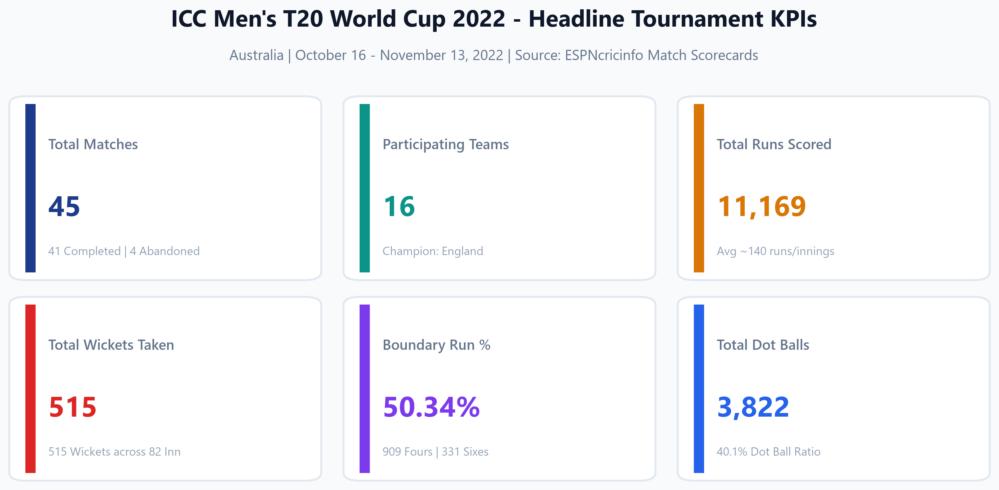
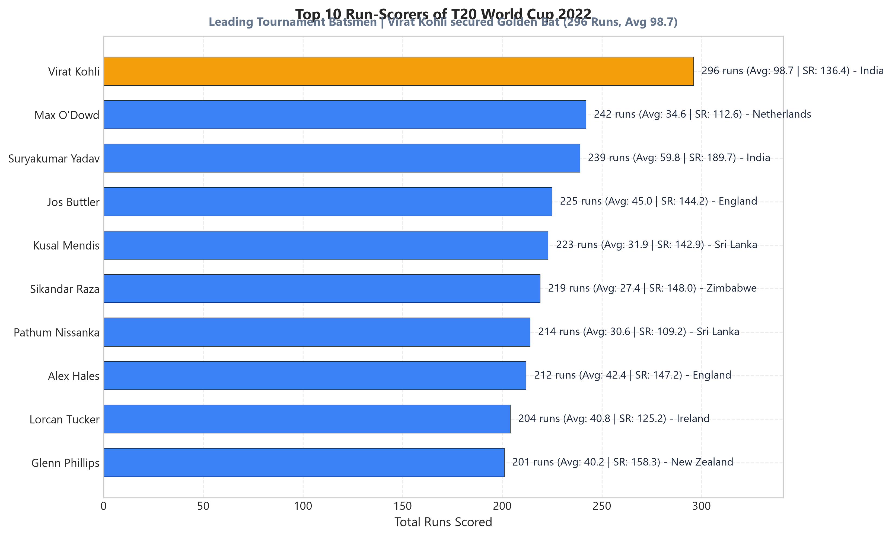
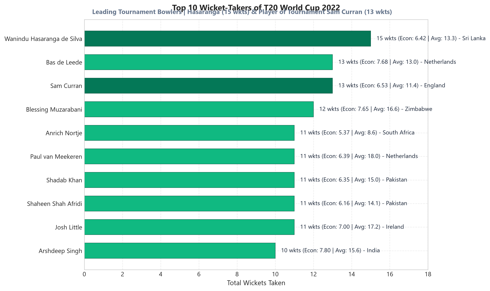
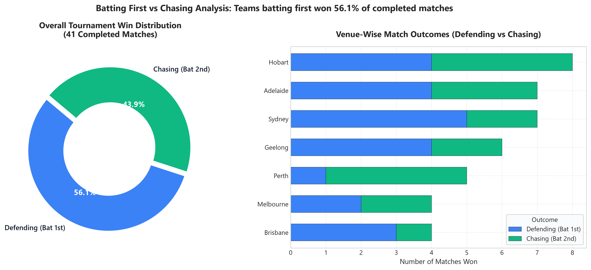
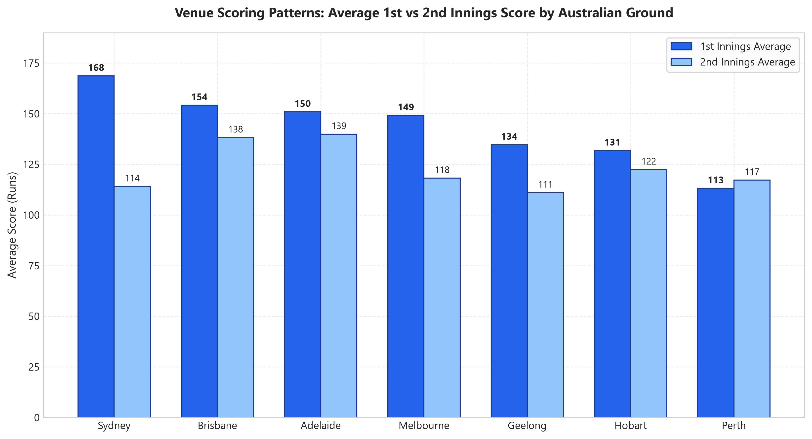
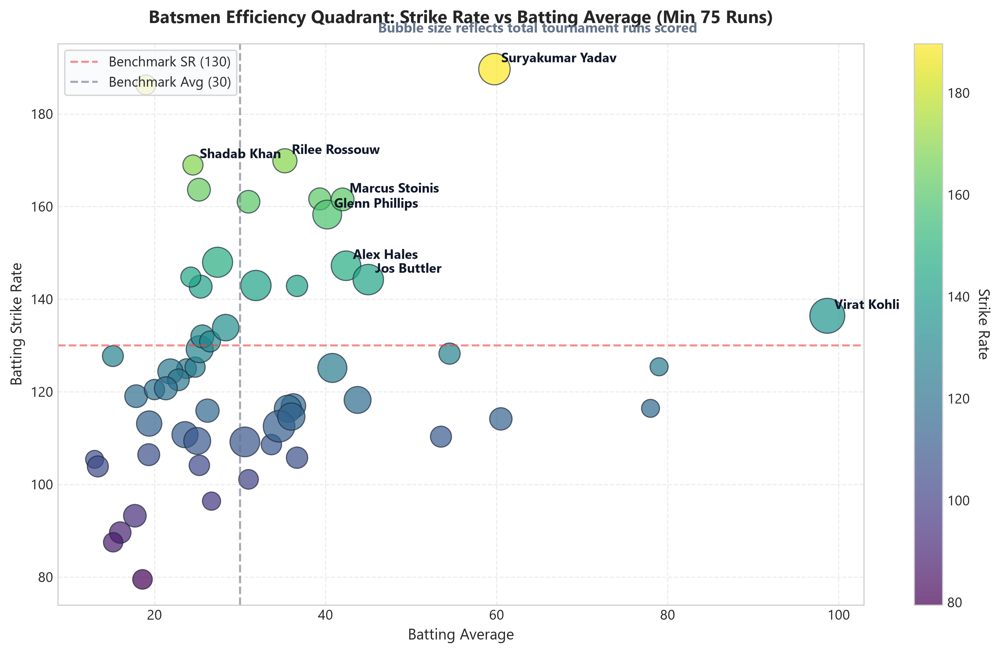

# ICC Men's T20 World Cup 2022 - End-to-End Data Analytics Portfolio Project

[](https://www.python.org/)
[](https://pandas.pydata.org/)
[](https://seaborn.pydata.org/)
[](https://www.sqlite.org/)
[](https://powerbi.microsoft.com/)
[](LICENSE)

---

## 1. Project Overview

This repository presents an industry-standard, end-to-end data analytics project evaluating the **ICC Men's T20 World Cup 2022** held in Australia. 

Built using Python, Pandas, Matplotlib, Seaborn, SQLite, and Microsoft Power BI, this project transforms unstructured match and player data into clean relational tables, automated data pipelines, rigorous statistical summaries, and an interactive business intelligence dashboard.

```
       Raw JSON / Web Scorecards (ESPNcricinfo)
                          │
                          ▼
            Automated Python ETL Pipeline
             (src/data_processing.py & src/data_cleaning.py)
                          │
                          ▼
              Relational Star Schema (SQLite)
        ├── dim_match_summary    ├── fact_bating_summary
        └── dim_players          └── fact_bowling_summary
                          │
        ┌─────────────────┴─────────────────┐
        ▼                                   ▼
  Advanced SQL Suite             Python Visualizations & EDA
(sql/analysis_queries.sql)        (notebooks/ & outputs/charts/)
        │                                   │
        └─────────────────┬─────────────────┘
                          ▼
           Interactive Power BI Dashboard
         (dashboards/T20 Analytics Dashboard.pbix)
```

---

## 2. Business Questions & Analytical Scope

This study answers key strategic questions relevant to sports management, performance coaching, and tournament strategy:

1. **Defending vs Chasing Dynamics**: Does batting first or chasing offer a statistical advantage across Australian grounds?
2. **Venue-Specific Characteristics**: How do pitch conditions in Sydney, Melbourne, Perth, and Adelaide impact 1st and 2nd innings totals?
3. **Player Efficiency Archetypes**: How do anchor batsmen (e.g., Virat Kohli) compare against high-strike-rate accelerators (e.g., Suryakumar Yadav)?
4. **Bowler Dominance & Dot Balls**: Which bowling styles (wrist spin vs pace) achieved the highest dot ball ratios and lowest economy rates?
5. **Team Squad Construction**: What role combinations (batters, bowling all-rounders, death-over specialists) define tournament-winning teams?

---

## 3. Technology Stack

- **Data Engineering & Cleaning**: Python 3, Pandas, NumPy, Regular Expressions (`re`)
- **Exploratory Analysis**: Jupyter Notebooks
- **Relational Modeling & SQL**: SQLite 3, ANSI SQL (CTEs, Window Functions `DENSE_RANK()`, `ROW_NUMBER()`)
- **Data Visualization**: Matplotlib, Seaborn
- **Business Intelligence**: Microsoft Power BI Desktop (Star Schema, DAX Measures)
- **Version Control & Quality**: Git, GitHub, Python logging

---

## 4. Repository Structure

```
T20-World-Cup-Data-Analysis/
│
├── data/
│   ├── raw/                           # Original JSON data files
│   │   ├── t20_wc_match_results.json
│   │   ├── t20_wc_batting_summary.json
│   │   ├── t20_wc_bowling_summary.json
│   │   └── t20_wc_player_info.json
│   │
│   ├── processed/                     # Production-ready cleaned CSVs and SQLite DB
│   │   ├── matches_cleaned.csv
│   │   ├── batting_summary_cleaned.csv
│   │   ├── bowling_summary_cleaned.csv
│   │   ├── players_cleaned.csv
│   │   ├── team_performance_summary.csv
│   │   └── t20_world_cup.db
│   │
│   └── README.md                      # Data dictionary & schema documentation
│
├── notebooks/                         # Step-by-step analysis notebooks
│   ├── 01_data_exploration.ipynb     # Initial profiling & quality diagnostics
│   ├── 02_data_cleaning.ipynb        # Data transformation & pipeline validation
│   ├── 03_data_analysis.ipynb        # KPI calculations & strategic deep-dives
│   └── 04_data_visualization.ipynb   # Visual storytelling & chart renderings
│
├── src/                               # Modular, reusable Python source code
│   ├── __init__.py
│   ├── data_processing.py             # JSON extraction & schema validation
│   ├── data_cleaning.py               # Cleaning pipeline & feature engineering
│   ├── analysis.py                    # Analytical metrics & aggregator functions
│   ├── visualization.py               # Publication-grade chart generation
│   └── sql_runner.py                  # SQLite database builder & query tester
│
├── outputs/
│   ├── charts/                        # 10 High-resolution (300 DPI) figures
│   │   ├── 01_tournament_overview_kpis.png
│   │   ├── 02_top_run_scorers.png
│   │   ├── 03_top_wicket_takers.png
│   │   ├── 04_batting_first_vs_chasing.png
│   │   ├── 05_venue_wise_performance.png
│   │   ├── 06_team_win_margins_distribution.png
│   │   ├── 07_boundary_strike_rate_analysis.png
│   │   ├── 08_best_bowling_figures.png
│   │   ├── 09_player_roles_distribution.png
│   │   └── 10_highest_team_totals.png
│   │
│   └── reports/                       # Executive summary report
│       └── t20_world_cup_2022_executive_summary.md
│
├── sql/
│   └── analysis_queries.sql           # 15+ Production SQL queries with comments
│
├── dashboards/
│   ├── T20 Analytics Dashboard.pbix   # Power BI Dashboard file
│   └── README.md                      # Power BI data model & DAX documentation
│
├── requirements.txt                   # Environment dependencies
├── .gitignore                         # Standard exclusion rules
├── README.md                          # Main repository portfolio documentation
└── LICENSE                            # Open-source license
```

---

## 5. Data Cleaning & Transformation Pipeline

The raw data contained several data quality anomalies addressed during preprocessing:

1. **Character Encoding Scrapes**: Corrected unicode replacement characters (`\ufffd`), non-breaking spaces (`\xa0`), and special symbols present in scraped cricketer names.
2. **Captaincy Normalization**: Separated captain annotations (`(c)`) from player names into an explicit boolean feature `is_captain`, ensuring 100% key match between player profiles and match logs.
3. **Player Deduplication**: Identified and consolidated 6 duplicate player entries created during scraping.
4. **Relational Key Mapping**: Constructed a bidirectional match lookup dictionary mapping fixture titles (`Team A Vs Team B`) to official scorecard IDs (`match_id`).
5. **Data Type Casting**: Converted string-encoded match metrics (`runs`, `balls`, `overs`, `economy`) to strict numeric types (`int` and `float`).
6. **Feature Engineering**: Derived categorical and quantitative fields:
   - `win_type`: Classified as `Defending (Bat 1st)`, `Chasing (Bat 2nd)`, or `No Result`.
   - `margin_type` & `margin_value`: Extracted numeric margins across runs and wickets.
   - `strike_rate` & `is_out`: Recomputed accurate strike rates and dismissal flags.

To re-run the cleaning pipeline:
```bash
python src/data_cleaning.py
```

---

## 6. Key Findings & Strategic Insights

All insights are grounded directly in the verified tournament dataset:

### A. Tournament Headline KPIs
- **45 Scheduled Matches**: 41 completed, 3 abandoned due to weather, 1 no-result.
- **Tournament Champion**: **England** defeated Pakistan by 5 wickets in the final at Melbourne.
- **Scoring Volume**: **11,169 total runs** scored and **515 wickets** taken across the tournament.
- **Boundary Dominance**: **50.34%** of all runs scored originated from boundaries (909 fours, 331 sixes).
- **Dot Ball Pressure**: **3,822 dot balls** were bowled, representing a **40.1% dot-ball ratio**.

### B. Defending (Batting First) vs Chasing
- Teams batting first won **56.1% (23 of 41)** of completed fixtures.
- **Sydney Cricket Ground (SCG)** and **Adelaide Oval** exhibited the strongest defending bias (**71.4% win rate** for teams batting first).
- **Perth Stadium** was the primary venue favoring chasing teams (60% chase wins) due to pitch stabilization under lights.

### C. Batting Standouts
- **Top Run Scorer**: **Virat Kohli (India)** — 296 runs in 6 innings at an average of **98.67** and strike rate of **136.41**.
- **Highest Impact Striker**: **Suryakumar Yadav (India)** — 239 runs at a tournament-leading strike rate of **189.68** and average of **59.75**.
- **Leading Tournament Openers**: Max O'Dowd (Netherlands, 242 runs), Jos Buttler (England, 225 runs), and Kusal Mendis (Sri Lanka, 223 runs).

### D. Bowling Standouts
- **Leading Wicket-Taker**: **Wanindu Hasaranga (Sri Lanka)** — 15 wickets (Economy 6.42, 74 dot balls).
- **Player of the Tournament**: **Sam Curran (England)** — 13 wickets at an average of **11.38**, including tournament-best figures of **5/10 (3.4 ov)** against Afghanistan.
- **Most Economical Fast Bowler**: **Anrich Nortje (South Africa)** — 11 wickets with an economy rate of **5.37** and average of **8.55**.

---

## 7. Visualizations Gallery

All charts are exported at **300 DPI** inside `outputs/charts/`.

### Headline KPIs Dashboard


### Top Run Scorers of the Tournament


### Leading Tournament Wicket-Takers


### Batting First vs Chasing Analysis


### Venue Scoring Characteristics (1st vs 2nd Innings)


### Batsmen Efficiency Quadrant (Strike Rate vs Average)


To regenerate all figures:
```bash
python src/visualization.py
```

---

## 8. Relational Modeling & SQL Suite

The data has been structured into an analytical Star Schema and verified inside SQLite (`data/processed/t20_world_cup.db`).

The SQL analytics file (`sql/analysis_queries.sql`) contains 15+ production-ready queries covering:
- Tournament KPI summary aggregations
- Team standing calculations with conditional win splits
- Venue advantage percentages
- Batting position run contribution (Openers vs Middle Order vs Finishers)
- Bowling rankings with `DENSE_RANK()` and single-match figures with `ROW_NUMBER()`
- Multi-skill MVP All-Rounder evaluations

### Running the SQL Engine:
```bash
python src/sql_runner.py
```

---

## 9. Interactive Power BI Dashboard

The project includes an interactive Power BI report located at `dashboards/T20 Analytics Dashboard.pbix`.

**Key Capabilities**:
- Dynamic star-schema modeling linking fact summaries to match and player dimensions.
- Custom DAX measures for Batting Averages, Boundary Run %, Bowling Economy, and Dot Ball %.
- Interactive filtering by team, venue, playing role, and match stage.
- Best XI selection framework based on performance thresholds.

*See [`dashboards/README.md`](dashboards/README.md) for full DAX specifications and model diagrams.*

---

## 10. Getting Started & Installation

### Prerequisites
- Python 3.10 or higher
- Git

### Setup Instructions
```bash
# 1. Clone the repository
git clone https://github.com/jiya-08/T20-World-Cup-Data-Analysis.git
cd T20-World-Cup-Data-Analysis

# 2. Create and activate a virtual environment (recommended)
python -m venv venv
# On Windows:
venv\Scripts\activate
# On macOS/Linux:
source venv/bin/activate

# 3. Install required packages
pip install -r requirements.txt

# 4. Run data cleaning pipeline
python src/data_cleaning.py

# 5. Run statistical analysis
python src/analysis.py

# 6. Generate charts
python src/visualization.py

# 7. Run SQL analytics engine
python src/sql_runner.py
```

---

## 11. GitHub Repository

- **Repository URL**: [https://github.com/jiya-08/T20-World-Cup-Data-Analysis](https://github.com/jiya-08/T20-World-Cup-Data-Analysis)

---

## 12. Author & Contact

- **Author**: Jiya Joshi
- **GitHub**: [jiya-08](https://github.com/jiya-08)
- **Specialization**: Data Analytics, Python ETL, SQL Query Optimization, Power BI Dashboarding
