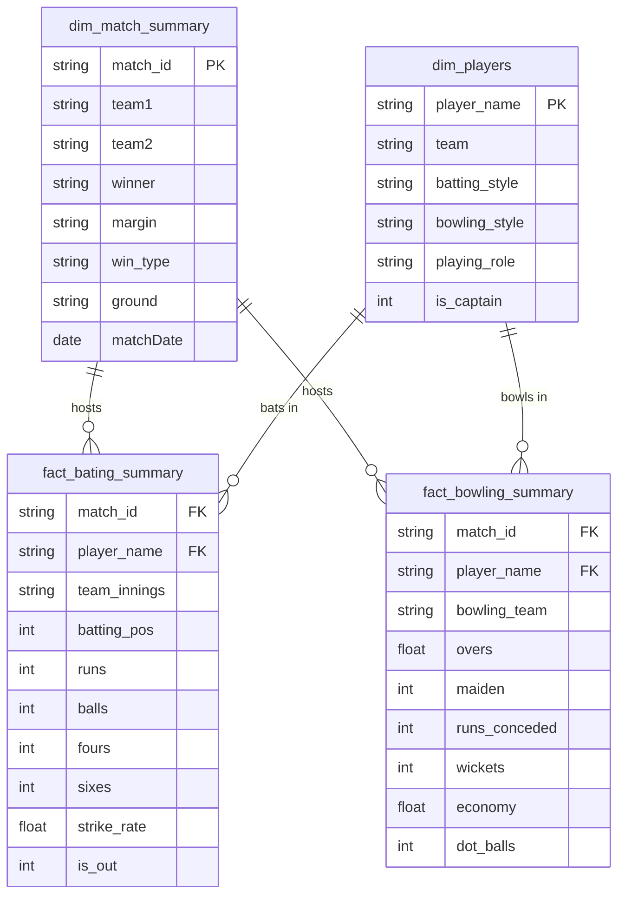

# Data Dictionary & Schema Documentation

## 1. Overview
This directory contains the datasets for the **ICC Men's T20 World Cup 2022 Data Analysis Project**.
The data originates from match scorecards and player performance metrics collected from ESPNcricinfo, covering 45 matches played across Australia in October–November 2022.

The data follows a dimensional **Star Schema** architecture optimized for analytics:
- **Fact Tables**: Granular event & performance data (`fact_bating_summary`, `fact_bowling_summary`).
- **Dimension Tables**: Contextual entity data (`dim_match_summary`, `dim_players`).

---

## 2. Directory Structure
```
data/
├── raw/
│   ├── t20_wc_match_results.json    # Original JSON containing match-level results
│   ├── t20_wc_batting_summary.json  # Original JSON containing batsman innings records
│   ├── t20_wc_bowling_summary.json  # Original JSON containing bowling spell records
│   ├── t20_wc_player_info.json      # Original JSON containing player profile metadata
│   └── original_csv/                # Initial raw CSV conversions
├── processed/
│   ├── matches_cleaned.csv          # Cleaned match results with derived outcome columns
│   ├── batting_summary_cleaned.csv  # Cleaned batting innings with standardized datatypes
│   ├── bowling_summary_cleaned.csv  # Cleaned bowling spells with standardized datatypes
│   ├── players_cleaned.csv          # Cleaned, deduplicated player master dimension
│   └── team_performance_summary.csv# Aggregated team-level tournament performance
└── README.md
```

---

## 3. Data Dictionary

### A. Matches Dataset (`matches_cleaned.csv` / `dim_match_summary`)
Primary Key: `match_id`

| Column Name | Data Type | Description | Sample Values |
| :--- | :--- | :--- | :--- |
| `match_id` | String | Unique identifier for each T20 match | `T20I # 1823`, `T20I # 1825` |
| `team1` | String | First team listed on match scorecard | `Namibia`, `India`, `Pakistan` |
| `team2` | String | Second team listed on match scorecard | `Sri Lanka`, `Netherlands` |
| `winner` | String | Winning team name or match outcome | `Namibia`, `England`, `abandoned` |
| `margin` | String | Winning margin as stated in scorecard | `55 runs`, `5 wickets` |
| `margin_type` | String | Type of victory (`runs` = defended, `wickets` = chased) | `runs`, `wickets`, `no_result` |
| `margin_value`| Integer | Quantitative margin of victory | `55`, `5`, `0` |
| `win_type` | String | Match outcome classification | `Defending (Bat 1st)`, `Chasing (Bat 2nd)`, `No Result` |
| `ground` | String | Host venue / city in Australia | `Geelong`, `Hobart`, `Sydney`, `Melbourne` |
| `matchDate` | Date | Date of the match (`YYYY-MM-DD`) | `2022-10-16`, `2022-11-13` |

### B. Batting Summary (`batting_summary_cleaned.csv` / `fact_bating_summary`)
Foreign Key: `match_id` references `matches_cleaned(match_id)`
Foreign Key: `player_name` references `players_cleaned(player_name)`

| Column Name | Data Type | Description | Sample Values |
| :--- | :--- | :--- | :--- |
| `match_id` | String | Foreign key to `matches_cleaned` | `T20I # 1823` |
| `match` | String | Match fixture description | `Namibia Vs Sri Lanka` |
| `team_innings` | String | Team currently batting | `Namibia`, `Sri Lanka` |
| `innings_order`| Integer | Innings number (1 = Batting 1st, 2 = Chasing) | `1`, `2` |
| `batting_pos` | Integer | Batting position in batting lineup | `1`, `2`, ..., `11` |
| `player_name` | String | Standardized player name | `Virat Kohli`, `Suryakumar Yadav` |
| `dismissal` | String | Description of dismissal method | `c Buttler b Curran`, `not out` |
| `is_out` | Integer | Binary indicator: 1 if dismissed, 0 if not out | `1`, `0` |
| `runs` | Integer | Total runs scored in the innings | `82`, `51`, `0` |
| `balls` | Integer | Total balls faced in the innings | `53`, `25`, `1` |
| `fours` | Integer | Number of 4s hit | `6`, `4`, `0` |
| `sixes` | Integer | Number of 6s hit | `4`, `1`, `0` |
| `strike_rate` | Float | Batting Strike Rate (`(runs / balls) * 100`) | `154.72`, `204.00` |

### C. Bowling Summary (`bowling_summary_cleaned.csv` / `fact_bowling_summary`)
Foreign Key: `match_id` references `matches_cleaned(match_id)`
Foreign Key: `player_name` references `players_cleaned(player_name)`

| Column Name | Data Type | Description | Sample Values |
| :--- | :--- | :--- | :--- |
| `match_id` | String | Foreign key to `matches_cleaned` | `T20I # 1823` |
| `match` | String | Match fixture description | `Namibia Vs Sri Lanka` |
| `bowling_team` | String | Team fielding and bowling | `Sri Lanka`, `Pakistan` |
| `player_name` | String | Standardized bowler name | `Sam Curran`, `Wanindu Hasaranga` |
| `overs` | Float | Overs bowled (e.g., 4.0, 3.2) | `4.0`, `3.2` |
| `maiden` | Integer | Number of maiden overs bowled | `0`, `1` |
| `runs_conceded`| Integer | Total runs conceded during spell | `10`, `28` |
| `wickets` | Integer | Total wickets taken during spell | `5`, `3`, `0` |
| `economy` | Float | Economy rate (`runs / overs`) | `2.50`, `7.25` |
| `dot_balls` | Integer | Number of dot balls (0s) bowled | `16`, `12` |
| `fours_conceded`| Integer| Number of boundaries (4s) conceded | `1`, `3` |
| `sixes_conceded`| Integer| Number of sixes conceded | `0`, `2` |
| `wides` | Integer | Number of wide balls bowled | `0`, `2` |
| `no_balls` | Integer | Number of no-balls bowled | `0`, `1` |

### D. Players Dimension (`players_cleaned.csv` / `dim_players`)
Primary Key: `player_name`

| Column Name | Data Type | Description | Sample Values |
| :--- | :--- | :--- | :--- |
| `player_name` | String | Standardized unique player name | `Virat Kohli`, `Sam Curran` |
| `team` | String | National team represented | `India`, `England`, `Pakistan` |
| `batting_style`| String | Player batting orientation | `Right hand Bat`, `Left hand Bat` |
| `bowling_style`| String | Player bowling classification | `Right arm Offbreak`, `Left arm Fast` |
| `playing_role` | String | Functional role in team | `Batter`, `Bowler`, `Allrounder` |
| `is_captain` | Integer | Binary indicator: 1 if captain | `1`, `0` |
| `description` | String | Official biographical summary | Player bio text |

---

## 4. Entity-Relationship Diagram (ERD)


